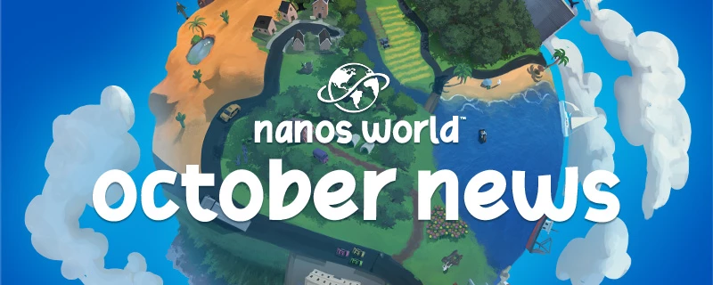

**Announcing the Halloween Game Jam winners, the new Playground, new Sandbox tools & entities, an improved Server Browser, Team Recruiting, better Lua safeguards and much more!**



<MediaLegend>October News</MediaLegend>

Welcome to our roundup of the latest updates from the last month!

{/* truncate */}


## 🎃 Halloween Game Jam Winners! {/* #halloween-game-jam-winners */}

Our **Halloween Playtest** weekend is over! The entries were amazing and the competition was fierce. Thank you to everyone who joined, hosted a server, submitted a game-mode, voted and joined us on this fun weekend! 💙


<MediaLegend>Halloween Game Jam 2026</MediaLegend>


### The Overall Winner! {/* #the-overall-winner */}

[](https://nanos-world.com/game-jams/halloween-2026/entries/99328fbd-dc7c-4c0d-9ea4-8087e05c55b4)

Scoring `4.69` out of 5, we're proud to announce [Death in the Box](https://nanos-world.com/game-jams/halloween-2026/entries/99328fbd-dc7c-4c0d-9ea4-8087e05c55b4) is the overall winner of the **Halloween Game Jam 2026**! Congratulations to the [TimeTales](https://nanos-world.com/community/teams/2e201bf4-286a-497a-8672-3220feb9e092) team for winning the Game Jam!


### Overall Ranking {/* #overall-ranking */}


<MediaLegend>Halloween Game Jam 2026 Results</MediaLegend>


Congratulations to [CosmoSnail](https://nanos-world.com/community/teams/bee156e7-6f2c-4a5b-9b42-ec52518aa52c) and [Synlight](https://nanos-world.com/community/teams/f3748b59-87d9-445f-af51-ad6253cbf030) for being 2nd and 3rd place winners as well!

- 🥇 **1st Place:** `4.69` [Death in the Box](https://nanos-world.com/game-jams/halloween-2026/entries/99328fbd-dc7c-4c0d-9ea4-8087e05c55b4), by [TimeTales](https://nanos-world.com/community/teams/2e201bf4-286a-497a-8672-3220feb9e092)
- 🥈 **2nd Place:** `4.53` [Burn the Witch](https://nanos-world.com/game-jams/halloween-2026/entries/dc5ecff0-0c82-4edd-8d4f-30376d16c3fb), by [CosmoSnail](https://nanos-world.com/community/teams/bee156e7-6f2c-4a5b-9b42-ec52518aa52c)
- 🥉 **3rd Place:** `4.12` [Vantage](https://nanos-world.com/game-jams/halloween-2026/entries/56180876-f8e2-43bd-a8af-aa64c5eab2fb), by [Synlight](https://nanos-world.com/community/teams/f3748b59-87d9-445f-af51-ad6253cbf030)


### Category Winners {/* #category-winners */}

Also congratulations to all the winners in each category! The winners were selected based on the highest scores in each category!

- **Fun:** `4.56` [Burn the Witch](https://nanos-world.com/game-jams/halloween-2026/entries/dc5ecff0-0c82-4edd-8d4f-30376d16c3fb), by [CosmoSnail](https://nanos-world.com/community/teams/bee156e7-6f2c-4a5b-9b42-ec52518aa52c)
- **Theme Fit:** `4.77` [Death in the Box](https://nanos-world.com/game-jams/halloween-2026/entries/99328fbd-dc7c-4c0d-9ea4-8087e05c55b4), by [TimeTales](https://nanos-world.com/community/teams/2e201bf4-286a-497a-8672-3220feb9e092)
- **Creativity:** `4.74` [Death in the Box](https://nanos-world.com/game-jams/halloween-2026/entries/99328fbd-dc7c-4c0d-9ea4-8087e05c55b4), by [TimeTales](https://nanos-world.com/community/teams/2e201bf4-286a-497a-8672-3220feb9e092)


All the top 3 ranked and [participating](https://nanos-world.com/community/badges/ddbe3312-17c4-4e96-a35f-ef72c6051a7b) Badges have been sent to the team member accounts! Thank you again to everyone who participated, and for the amazing moments together! 💙


:::tip

Note that the ranking was determined by the votes from the community, and the category winners were selected by the highest Bayesian average score in each category, to ensure a fair and balanced evaluation of the entries.

:::


<ReferenceLink href="https://nanos-world.com/game-jams/halloween-2026/results-2026">Halloween 2026 Game Jam Results</ReferenceLink>


## Playtest Weekend {/* #playtest-weekend */}

nanos world was open for everyone to join this weekend, here are some screenshots of what happened!

<MediaGallery>


</MediaGallery>

<MediaLegend>Halloween 2026 Playtest screenshots</MediaLegend>


### Playtest Access Extended {/* #playtest-access-extended */}

We've extended the Playtest weekend until Sunday **November 8th**, so you can still join nanos world and try game-modes and our new Playground, and give your feedback on the **[Feedback Hub](https://nanos-world.com/feedback/ideas)**.

:::note

Note that after Sunday, only testers and players whitelisted by communities will still be able to play nanos world. If you don't have access, register to become a tester in our [Tester form](https://tester.nanos-world.com/)!

:::


## The New Playground! {/* #the-new-playground */}

Introducing... our new **[Playground](https://nanos-world.com/store/packages/default-playground-map)** map! 🎉

A big open sandbox to explore entities, physics, tools and easter eggs, made for messing around and trying what nanos world can do!


<MediaLegend>The new Playground map</MediaLegend>

The map has areas to try the tools, a shooting range, sports balls, trampolines, cameras, interactive props and more. It uses entities from **Sandbox**, so the things you find there can also be spawned and used in your own creations.

<MediaGallery>


</MediaGallery>

<MediaLegend>The Hub, Sandbox & Physics, Shooting Range, Entities, Museum and Sports areas</MediaLegend>

The Playground is available on the **Vault** and in our official Hub server! Don't forget to give it a try and review it!

<ReferenceLink href="https://nanos-world.com/store/packages/default-playground-map">Playground on the Vault</ReferenceLink>


### Default Testing Map as Package {/* #default-testing-map-as-package */}

With the new Playground map, our old **default-testing-map** is retiring. It was the first map we ever created for testing nanos world features, and it has been used for a lot of testing and demos over the years.

We've moved it to the Vault so it can be publicly seen.

<ReferenceLink href="https://nanos-world.com/store/packages/default-testing-map">Default Testing Map on the Vault</ReferenceLink>


## Playtest Achievements {/* #playtest-achievements */}

We've integrated Steam Achievements and Stats into the Playtest version, so you can now earn achievements and track your stats while playing Playtest too!


<MediaLegend>Achievements in the Playtest version</MediaLegend>


## Sandbox Got New Toys! {/* #sandbox-got-new-toys */}

Sandbox got a lot of new stuff this month, starting with new meshes for the **Physics Gun**, **Tool Gun** and **Puke Gun**!


<MediaLegend>The new Tool Gun, Physics Gun and Puke Gun</MediaLegend>

There are new **Doors**, **Balls**, **Chairs**, **Lamps**, animated **Targets** and a **Jukebox** with playlists and synchronized music. Buttons got more models, sounds and animations, and can be activated by damage.

We also added a **Material Gun** to change the material of objects and the **Color Gun** now supports choosing a material slot too!

The **TV** is now synchronized, **CCTV** has new camera models, and the **Photo Frame** got new frame options.


<MediaLegend>New Sandbox entities</MediaLegend>


## New Default Assets {/* #new-default-assets */}

### Animals & Skeleton {/* #animals--skeleton */}

The **default-characters** package got a new **Human Skeleton** and a collection of **Animals**! Chickens, cows, sheep, pigs, crocodiles, elephants, lions, wolves, a flying crow and more, all available in the Sandbox NPCs tab or in the Character selection menu.


<MediaLegend>New Animals and Human Skeleton in the default-characters package</MediaLegend>


### Fishing Boat Water Vehicle {/* #fishing-boat-water-vehicle */}

We added a new **Fishing Boat** to the default vehicles package, and improved water vehicles too!

They now reverse at half thrust, have better automatic buoyancy pontoon placement, and only block the throttle when every pontoon is fully submerged. We fixed boats floating at an angle or sinking at the stern when their mesh or center of mass was offset, and the camera no longer realigns because of the up and down movement on waves.


<MediaLegend>The new Fishing Boat</MediaLegend>

:::info

<MethodReference type="Class" class_name="VehicleWater" method_name="SetThrustStrength" show_class_name /> now uses **Newtons**, with a default of `3000`.

:::


### New Blasters {/* #new-blasters */}

The default weapons package got new **Blaster Pistol**, **Blaster Rifle** and **HFG** meshes, replacing the old Blaster and DC-15S assets.


<MediaLegend>The new Blaster Pistol, Blaster Rifle and HFG</MediaLegend>


### Surface Materials {/* #surface-materials */}

We added a new collection of default **Surface Materials**: wood, brick, concrete, stone, marble, gravel, dirt, roof tiles, metals, wallpaper, plastic, rubber, neon and more!

They use the new **Triplanar** template material, which projects textures onto the object without depending on its UVs. The texture follows the object when it moves or rotates, and keeps the same size when the object is scaled.

You can try them with the new **Material Gun**, or use them directly in your scripts.

<ReferenceLink href="assets-modding/default-asset-pack/default-materials#surface-materials">Default Surface Materials</ReferenceLink>


## Physics, Audio & Sync Improvements {/* #physics-audio--sync-improvements */}

### Sleeping Objects Can Rest {/* #sleeping-objects-can-rest */}

We found that resting physics objects were still generating **Hit** events every physics step. Now these resting contacts are filtered, buoyancy only updates while a body is awake, and sleeping weapons stop updating their skeletal physics every frame.

We also fixed already loaded assets bypassing Unreal's cache and going through the loading path again.

This should reduce CPU usage and improve performance on clients with many physics objects such as weapons or props.


### Runtime Audio Rewrite {/* #runtime-audio-rewrite */}

Runtime Sounds (.ogg) loaded from package files are now decoded in real time by the engine, instead of being fully decoded into memory when loaded. A three-minute Ogg that previously took around **70 MB** of decoded audio now keeps the compressed file data in memory instead, reducing the overall memory usage of the game.

Looping, seeking and playing the same sound multiple times now use the engine's native audio system. We also fixed sound attenuation leaking between sounds that used the same asset, improved the range of footsteps and other short sounds, and fixed music losing its priority when too many sounds were playing.

Please let us know if you notice any issues or stutters when loading sounds!


### More Precise Synchronization {/* #more-precise-synchronization */}

We improved rotation precision over the network, fixing the stepped aiming rotation you could see on other players (especially while spectating). Rotations sent through remote events benefit from this too.

The *experimental* **Based Sync** system got more fixes: Characters standing on a client-side mesh attached to a synchronized entity now follow that entity correctly for other players. We also fixed Characters sliding back after detaching from moving objects, and desync when jumping on moving platforms.

Other improvements include fixing ragdoll jitter when the mesh is hidden or off screen and inputs (like firing) being missed at low FPS.


## UI Improvements {/* #ui-improvements */}

### Server Browser & Filters {/* #server-browser--filters */}


<MediaLegend>The improved Server Browser with sorting and filters</MediaLegend>

The **Server Browser** got a lot of love this month! It now lists compatible servers first, followed by the lowest ping and most players, and it can be sorted by **Ping** and **Player Count**. Search also matches game modes and maps, the filters are kept when you come back to the main menu, and the players tooltip shows how many players are connecting.

We also fixed the list sometimes refreshing with 0 servers: Steam was throttling our requests, so now the full list is requested at most every 30 seconds, and only the known servers are queried in between.


### Escape Menu {/* #escape-menu */}

The Escape Menu got some big improvements as well!

Holding **Escape** now always opens the native Escape Menu, even when a script blocks the Escape press to show its own menu.

#### Player Profiles {/* #player-profiles */}


<MediaLegend>Escape Menu Profile</MediaLegend>

Player profiles can now be opened from the in-game player list, showing their teams and badges, and your own account, achievements and stats. **Join Friend** works from there too.


#### Vault Map & Game Mode Pages {/* #vault-map--game-mode-pages */}

<MediaGallery>


</MediaGallery>

<MediaLegend>Escape Menu Vault Map & Game Mode Pages</MediaLegend>

You can now click the current server's Map and Game Mode in the Escape Menu to open their Vault pages, with their description, reviews and screenshots, and rate and review them right there!


#### Game Jam Tab {/* #game-jam-tab */}


<MediaLegend>Escape Menu Game Jam tab</MediaLegend>

During the Game Jam, the Escape Menu got a **Game Jam** tab listing every entry and its servers, so you could jump between game-modes and vote without leaving the game.


### Improved Review Widgets {/* #improved-review-widgets */}


<MediaLegend>Improved review widget</MediaLegend>

The in-game **Review** and **Rating** widgets for Vault resources and Game Jam entries were redesigned to match the website, making it quicker to rate and review what you play.


### Other UI Improvements {/* #other-ui-improvements */}

A few other changes:

- New **Steam Branch Selector** on the News balloon, to switch between bleeding-edge and default.
- The launch error popup now explains why Steam failed to start: Steam not running, an outdated client, or missing game or Playtest access.
- New settings to disable the initial loading video and the typing sounds.
- **Clear All Cache** now shows how much space was freed.
- The hardware benchmark now picks upscaling, latency reduction and hardware ray tracing based on your hardware and results.
- Vehicle tooltips now say if you will enter as driver or passenger.


## Website & Community {/* #website--community */}

### Introducing... Recruiting for Teams! {/* #introducing-recruiting-for-teams */}


<MediaLegend>Community Recruiting page with open positions and filters</MediaLegend>

Teams can now post **open positions** on the new **[Recruiting](https://nanos-world.com/community/recruiting)** page!

Each position can list the skill you're looking for, compensation, budget, commitment, languages and a contact, and can optionally be linked to one of your Projects. People can search and filter the list to find something that fits them.

Positions also appear on Team and Project pages, and the **Hub** shows new positions. Teams can edit, renew, close or reopen them from their manage page, and Projects now have their own **Recruiting** management tab.

:::note

Recruiting is a directory: people get in touch through the contact in the position. Any agreement, work or payment is handled directly between the people involved. nanos world is not responsible for any agreements or disputes.

:::

<ReferenceLink href="https://nanos-world.com/community/recruiting">Find a Team or Post a Position</ReferenceLink>


### Resource & Project Statistics {/* #resource--project-statistics */}


<MediaLegend>Resource statistics dashboard with daily charts and period comparisons</MediaLegend>

Resources and Projects now have statistics charts on their manage pages, showing daily **Views**, **Downloads** where applicable, and **Favorites**. The stat cards also show comparisons with the previous period.


### Team Invites {/* #team-invites */}


<MediaLegend>Team invites</MediaLegend>

Adding someone to a Team now sends an **invitation**. They can accept or decline it, and pending invites appear as notifications on their account page. We also added a **Leave Team** button.


### New Crash Lookup {/* #crash-lookup */}


<MediaLegend>The new Crash Lookup page</MediaLegend>

The **Crash Reporter** now links to your report on the new **[Crash Lookup](https://nanos-world.com/crash)** page. It shows possible causes, including out-of-memory errors and corrupted assets. It helps you tell whether a crash comes from corrupted or broken assets, or is a game crash you should report to us!

<ReferenceLink href="https://nanos-world.com/crash">Crash Lookup</ReferenceLink>


### New Navbar Menus {/* #new-navbar-menus */}

The website also has new navbar menus, with a new **Help** tab, bringing Support, Feedback, Crash Lookup, documentation, server status and troubleshooting together.


<MediaLegend>The new Help menu</MediaLegend>


### Content Guidelines {/* #content-guidelines */}

We added a dedicated **[Content Guidelines](https://nanos-world.com/guidelines)** page, with recommendations and explanations for what you can publish, names, other people's work, AI-generated content, safe code and reporting.

If you're preparing a Resource, Team or Project page, give it a read before publishing!


### Other Website Improvements {/* #other-website-improvements */}

Profile, Team, Project, Resource and Game Jam entry editing now uses a unified save flow. Screenshots can be reordered with **drag and drop**, and we fixed errors when uploading or rearranging images while they were still being processed.

The resource **Versions** tab now renders changelogs as markdown, has a shared "show more information" toggle, and lets you hide old deleted or declined versions. Resources can also be renamed from their manage page's **Danger Zone**.

Images attached to Feedback, Bugs and Support discussions now open in a gallery you can step through with arrows, keys or swipes, and reviews show when they were last edited.


## Scripting Improvements {/* #scripting-improvements */}

### Steam Friend Invites {/* #steam-friend-invites */}

We added <MethodReference type="StaticClass" class_name="Steam" method_name="OpenInviteDialog" show_class_name /> and <MethodReference type="StaticClass" class_name="Steam" method_name="InviteFriend" show_class_name /> to invite friends to your current server!

On the joining player's side, <MethodReference type="StaticClass" class_name="Steam" method_name="GetJoinedFromFriend" show_class_name /> returns the SteamID of the friend whose invite brought them there. If they accept an invite to the server they're already on, the <EventReference type="StaticClass" class_name="Steam" event="FriendJoin" /> event fires instead of reconnecting them.

```lua title="Client/Index.lua" showLineNumbers
Input.Register("InviteFriends", "F7", "Invite Steam friends to the server")

Input.Bind("InviteFriends", InputEvent.Pressed, function()
	Steam.OpenInviteDialog()
end)
```


### Package Load & Unload Events {/* #package-load--unload-events */}

<StaticClasses.Server /> and <StaticClasses.Client /> now have <EventReference type="StaticClass" class_name="Server" event="PackageLoad" /> and <EventReference type="StaticClass" class_name="Server" event="PackageUnload" /> events, so you can react when other packages load or unload.

```lua title="Server/Index.lua" showLineNumbers
Server.Subscribe("PackageLoad", function(package_name)
	Console.Log("Loaded package: " .. package_name)
end)
```

We also fixed <MethodReference type="StaticClass" class_name="Server" method_name="LoadPackage" show_class_name /> not sending a newly loaded package to players already connected.


### New Relative Movement {/* #new-relative-movement */}

New <MethodReference type="Class" class_name="Actor" method_name="TranslateRelativeTo" show_class_name /> and <MethodReference type="Class" class_name="Actor" method_name="RotateRelativeTo" show_class_name /> smoothly move or rotate an attached Actor relative to its parent, while continuing to follow the parent's movement.


### New Reset Velocity {/* #new-reset-velocity */}

We also added <MethodReference type="Class" class_name="Actor" method_name="ResetVelocity" show_class_name /> to clear linear and angular velocity. On Pawns it clears the movement velocity too, useful when teleporting a Character without carrying its old momentum.


### Open Mic {/* #open-mic */}

Voice chat now has an **Open Mic** mode alongside **Push to Talk**, selectable in the Audio settings. In Open Mic mode, the voice key toggles your microphone mute state, and the Escape Menu shows whether it is open or muted (and you can mute/unmute there too).

Scripts can read that state with <MethodReference type="StaticClass" class_name="Client" method_name="IsVOIPSelfMuted" show_class_name /> and listen to <EventReference type="StaticClass" class_name="Client" event="VOIPSelfMuteChange" /> to update their own voice indicators.

#### New Voice Volume Normalization {/* #new-voice-volume-normalization */}

We also added a new audio processing system that tries to normalize everyone's microphone volume into a consistent range.

Also now the **Mic Test** works in the main menu too!

Please let us know how your voice sounds now!


### Lua Sandboxing {/* #lua-sandboxing */}

Players join servers they can't fully trust, so we hardened the Lua environment that runs server scripts on their machines:

- The `debug` library is now disabled, except `debug.traceback`, `debug.getinfo`, `debug.sethook` and `debug.gethook`, as the others let a script read and change other scripts' internals.
- Loading precompiled Lua bytecode is now blocked, with `load` or as Package files. Only text chunks can be loaded.
- Scripts tampering with class tables can no longer make one entity type be read as another.

To help debugging your own scripts, the whole `debug` library can be enabled on the client in the new **Settings > Debug** option. It is never saved, so it only lasts until you close the game. Only use it on servers you trust!

<ReferenceLink href="core-concepts/packages/package-loading-and-lua-environment">Package Loading & Lua Environment</ReferenceLink>


#### Other Security Improvements {/* #other-security-improvements */}

- Client Lua files are now **encrypted** with keys only sent to authenticated players, so they can no longer be read from the cache folder or downloaded from the server without joining it.
- Several networking messages are now strictly validated before being read and processed.

:::tip

We are still working on improving the Lua sandboxing and security, and we will keep adding more safeguards in future updates. If you find a bypass or any vulnerability, please report it to us privately through the **[Support](https://nanos-world.com/support)** page instead of sharing it publicly, so we can fix it!

:::


### Other Scripting Improvements {/* #other-scripting-improvements */}

- New <MethodReference type="StaticClass" class_name="Chat" method_name="Submit" show_class_name /> submits a message through the normal chat flow, including chat commands, useful for custom chat interfaces.
- Chat messages are now sent only to players in the same dimension.
- New <MethodReference type="StaticClass" class_name="Timer" method_name="Unbind" show_class_name /> removes an Actor binding without clearing or resetting the Timer.
- Morph targets and <MethodReference type="Class" class_name="Pawn" method_name="SetTeam" show_class_name /> now work across Pawn types, and morph targets survive mesh changes.
- New <MethodReference type="Class" class_name="Pawn" method_name="SetAIStopWithBraking" show_class_name /> lets AI brake to a stop instead of halting instantly, disabled by default.
- New <MethodReference type="Class" class_name="Prop" method_name="SetOneWayInteraction" show_class_name /> controls one-way physics interaction.
- New <MethodReference type="StaticClass" class_name="Sky" method_name="SetMoonMaterialColor" show_class_name /> and <MethodReference type="StaticClass" class_name="Sky" method_name="SetMoonLightColor" show_class_name /> customize the moon.
- Sound, particle, crosshair, parachute texture and physics asset setters now accept `nil` or an empty string to clear the asset.
- New <MethodReference type="Class" class_name="Actor" method_name="SetImpulseOnDamage" show_class_name />, <MethodReference type="Class" class_name="Pickable" method_name="SetPickable" show_class_name /> and <MethodReference type="Class" class_name="Cable" method_name="SetVisibility" show_class_name />.
- New <MethodReference type="Class" class_name="SceneCapture" method_name="SetLODDistanceFactor" show_class_name />, and <MethodReference type="Class" class_name="SceneCapture" method_name="EncodeToBase64" show_class_name /> got optional output dimensions.
- <MethodReference type="Class" class_name="Grenade" method_name="Explode" show_class_name /> got an optional instigator parameter.
- `AttachTo()` with `KeepWorld` / `KeepRelative` now works properly on client-side actors.
- `assets://` and `package://` paths without an extension now try `.png` then `.jpg`.
- Package and asset files with non-ANSI names now work on Windows.
- The default network send rate is now **2 MB/s**.


### Dependencies Updated {/* #dependencies-updated */}

- Updated **CEF** to v154.
- Updated **NVIDIA DLSS** to v8.8.0.
- Updated **AMD FSR** to v4.1.1 and **AMD Anti-Lag** to v2.0.5.
- Updated **Sentry** to v1.24.0 and **Discord SDK** to v1.10.19337.
- Updated **SOCI** to v4.1.4, **libpq** to v17.11, **xxHash** to v0.8.4 and **mimalloc** to v3.5.1.


## Docs {/* #docs */}

The **[Troubleshooting Guide](/docs/next/troubleshooting)** was expanded with more information and help for known issues. We also updated the **[VOIP Guide](/docs/next/core-concepts/scripting/voip)** and the **[Store Guide](/docs/next/vault-and-store/store)**.


## Conclusion {/* #conclusion */}

October was a big month with tons of new features, improvements and fixes. This month's news blog was huge, and I probably even forgot to cover some features in it! 😅

It's always a joy to run a public Playtest, and have a lot of new players joining and testing what we've been working on.

I already mentioned that I have a lot of fun creating new game-modes and maps, because that makes me see the game with different eyes and I always find new ways to improve it. But seeing the community creating their own content and sharing it with us is even more rewarding. I hope you enjoy exploring the new map and trying the new game-modes and tools!

A special thank you to everyone who put time into a Game Jam entry, helped host servers or spent the weekend testing and reporting issues!

Thank you too to everyone supporting development through **[Ko-fi](https://ko-fi.com/gtnardy)** and contributing translations through **[Crowdin](https://crowdin.com/project/nanos-world-game)**. Your support helps me keep working on nanos world full-time. 💙

Keep sharing your creations and feedback with us on **[Discord](https://discord.gg/nanos-world)** and the **[Feedback Hub](https://nanos-world.com/feedback/ideas)**!

See you in the next update! 🚀

<KofiButton />
